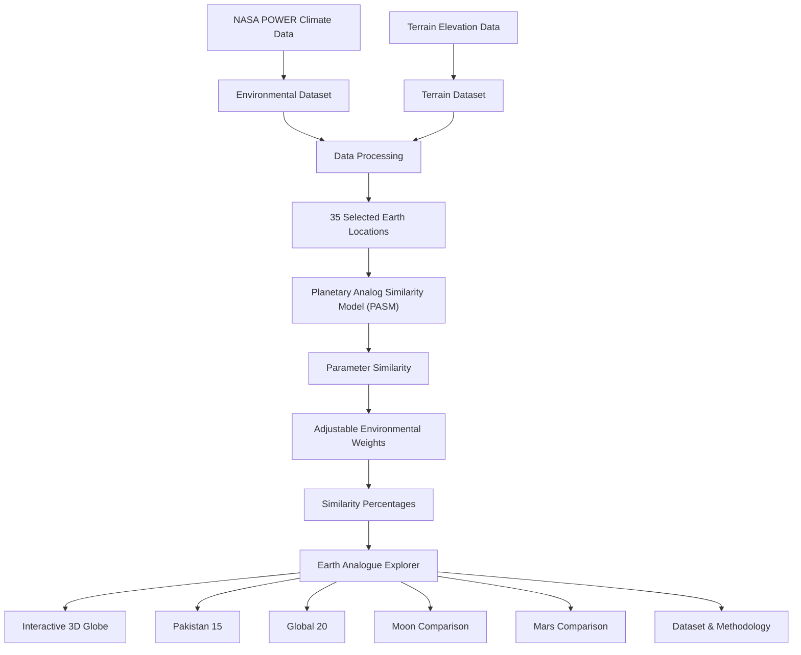

# 🌍 Earth Analogue Explorer
### Finding Places on Earth That Are Similar to the Moon and Mars

  
  
  
  

  

## 🚀 Live Web Version

🌐 **Explore Earth Analogue Explorer:**  
[Click here to open the live website](https://nigarish12564.github.io/NASA-SpaceAppsChallege/#overview)

**Earth Analogue Explorer** is an interactive web application developed for the NASA Space Apps Challenge.

- 🌎 Explore 35 locations on Earth.
- 🇵🇰 Discover 15 locations across Pakistan.
- 🌐 Explore 20 international locations.
- 🌕 Compare Earth locations with the Moon.
- 🔴 Compare Earth locations with Mars.
- ⚖️ Adjust environmental weights and explore similarity percentages.

---

## 🪐 Explore the Moon & Mars

<table>
  <tr>
    <td align="center" width="50%">
      
      <h3>🌕 The Moon</h3>
    </td>
    <td align="center" width="50%">
      
      <h3>🔴 Mars</h3>
    </td>
  </tr>
</table>

---

## 🎯 The Problem

Finding places on Earth that have environmental and geographical conditions similar to the Moon and Mars is challenging.

- 🌡️ Different planetary environments have different temperature conditions.
- 💧 Rainfall and humidity affect the characteristics of Earth locations.
- 🏔️ Terrain features such as slope and elevation also matter.
- 🔍 Comparing many locations and environmental factors manually takes time.

Our goal is to make these comparisons easier through one interactive platform.

## 💡 Our Solution

We developed Earth Analogue Explorer to help users explore and compare selected Earth locations with Moon and Mars conditions.

- 📍 Evaluate 35 selected Earth locations.
- 🌍 Explore locations through an interactive 3D globe.
- 📊 Compare environmental and terrain characteristics.
- 🧮 Calculate similarity percentages using our Planetary Analog Similarity Model (PASM).
- ⚖️ Adjust environmental weights to explore different comparison results.

---

## ✨ Key Features

### 🌎 1. Interactive 3D Earth Globe

- Explore a rotating 3D globe.
- Select locations directly through the globe.
- View the geographical position of selected sites.
- Explore different locations around the world.

### 🇵🇰 2. Pakistan's 15 Locations

Explore 15 selected locations across four regions of Pakistan.

| Region | Number of Locations |
|:---|---:|
| Balochistan | 6 |
| Gilgit-Baltistan | 4 |
| Sindh | 3 |
| Punjab | 2 |
| **Total** | **15** |

**Available filters:**
- View all 15 locations.
- Filter locations by region.

### 🌐 3. Global 20 Locations

Explore 20 international locations using different categories.

**Available filters:**

- 🌍 **All Global 20:** View all international locations.
- 🛰️ **NASA Documented:** Explore 13 locations marked as NASA documented.
- 🔴 **Mars Affinity:** Explore locations grouped by their Mars affinity.
- 🌕 **Moon Affinity:** Explore locations grouped by their Moon affinity.

### 🌕 4. Moon Comparison

- Compare selected Earth locations with lunar target conditions.
- View similarity percentages.
- Open full location details.
- Examine individual environmental parameters.

### 🔴 5. Mars Comparison

- Compare selected Earth locations with Martian target conditions.
- View similarity percentages.
- Explore detailed environmental comparisons.
- Examine individual parameter results.

### ⚖️ 6. Adjustable Environmental Weights

Different environmental factors can have different levels of importance.

Users can:

- Increase or decrease the weight of ambient temperature.
- Adjust the importance of precipitation.
- Change the weights of other environmental and terrain parameters.
- Recalculate similarity results using the selected weights.

### 📊 7. Detailed Location Analysis

- View the full details of selected locations.
- Examine ambient temperature and precipitation.
- Explore humidity, solar insolation, and terrain characteristics.
- Understand how individual parameters contribute to the comparison.

### 📁 8. Dataset & Methodology

- Explore the datasets used in the application.
- Understand the environmental parameters.
- Learn how the Planetary Analog Similarity Model works.

---

## 🔬 Environmental Parameters

Our model uses six environmental and geographical parameters to compare Earth locations with Moon and Mars conditions.

| Parameter | What It Measures |
|:---|:---|
| 🌡️ Ambient Temperature | Temperature of the surrounding air |
| 🌧️ Precipitation | Amount of rainfall |
| 💧 Relative Humidity | Moisture present in the air |
| ☀️ Solar Insolation | Solar energy received at the surface |
| 🏔️ Terrain Slope | Steepness of the land |
| ⛰️ Local Relief | Variation in elevation across an area |

---

## 🧮 Planetary Analog Similarity Model (PASM)

Our application uses the **Planetary Analog Similarity Model (PASM)** to calculate how closely an Earth location matches the selected Moon or Mars target conditions.

### ⚙️ How It Works

1. **Data Collection:** Gather environmental and terrain information for the selected locations.
2. **Parameter Evaluation:** Examine all six environmental and geographical parameters.
3. **Similarity Calculation:** Calculate how closely each parameter matches the target conditions.
4. **Weight Adjustment:** Apply user-selected weights to the parameters.
5. **Final Calculation:** Combine the weighted parameter similarities into an overall score.
6. **Results:** Display similarity percentages and detailed comparisons.

**The main idea:** Users can change the importance of environmental factors and see how the similarity results change.

---

## 🏗️ Application Architecture

The following diagram shows the main components of our application and the flow of information through the analysis process.

---

## 🛰️ Data Sources

Our project uses environmental and geographical information from the following sources:

| Data Source | Data Used |
|:---|:---|
| [NASA POWER](https://power.larc.nasa.gov/) | Temperature, precipitation, relative humidity, and solar insolation |
| [ASTER Global DEM](https://asterweb.jpl.nasa.gov/gdem.asp) | Elevation data for terrain analysis |
| [OpenTopoData](https://www.opentopodata.org/) | Elevation data access for terrain calculations |

These datasets help us examine the environmental and geographical conditions of the selected locations.

---

## 🛠️ Technologies Used

  
  
  
  
  
  
  
  
  
  

| Category | Technologies |
|:---|:---|
| Frontend | React, TypeScript, Vite |
| 3D Visualization | Three.js, React Three Fiber, Drei |
| Styling | Tailwind CSS |
| Data Processing | Python, Pandas, NumPy |
| Visualization | Plotly |
| Dashboard | Streamlit |
| Data Access | NASA POWER API, OpenTopoData |
| Deployment | GitHub Pages |
| Version Control | Git, GitHub |

---

## 🧭 Application Navigation

| Section | Features |
|:---|:---|
| 🏠 Overview | Project introduction and main exploration options |
| 🌎 3D Globe | Rotating interactive Earth globe |
| 🇵🇰 Pakistan 15 | Explore and filter Pakistan locations |
| 🌐 Global 20 | Explore international locations |
| 🌕🔴 Comparison | Separate Moon and Mars comparisons |
| ⚖️ Weights | Adjust environmental parameter weights |
| 📊 Dataset | Explore the datasets |
| 📖 Methodology | Understand the similarity model |

---

## 👩‍💻 Meet Our Team

We developed Earth Analogue Explorer as a team for the NASA Space Apps Challenge.

<table>
  <tr>
    <td align="center" width="33%">
      <a href="https://github.com/MaryamArif17">
        
         
        <strong>Maryam Arif</strong>
      </a>
       
     
    </td>
    <td align="center" width="33%">
      <a href="https://github.com/Nigarish12564">
        
         
        <strong>Nigarish</strong>
      </a>
       
      
    </td>
    <td align="center" width="33%">
      <a href="https://github.com/ZA709">
        
         
        <strong>ZA709</strong>
      </a>
       
      
    </td>
  </tr>
</table>

---

## 🌌 Our Goal

- 🌍 Make planetary analogue exploration easier to understand.
- 🔬 Bring environmental and geographical data together.
- 🌕 Explore possible Earth analogues for lunar environments.
- 🔴 Explore possible Earth analogues for Martian environments.
- 🚀 Support learning and research related to future space exploration.

---

## 🙏 Acknowledgements

We would like to thank:

- 🛰️ **NASA Space Apps Challenge** for the opportunity to work on a real-world space exploration challenge.
- 🌎 **NASA POWER** for providing environmental and climate data.
- 🏔️ **ASTER Global DEM** for terrain elevation data.
- 📡 **OpenTopoData** for elevation data access.
- 🔭 **NASA and the scientific community** for their planetary research and resources.

---

  <strong>🌍 Exploring Earth to Understand Other Worlds 🚀</strong>
   
  Made with teamwork for the NASA Space Apps Challenge.

